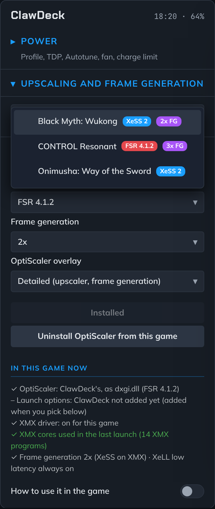

<p align="center">
  
</p>

<h1 align="center">ClawDeck</h1>

<p align="center"><b>Everything an Intel MSI Claw needs on Linux, in one Decky plugin.<br>FSR 4.1.2 and XeSS on the XMX cores, XeSS frame generation with low latency, power, fans and the fixes,<br>all from Steam's Quick Access menu.</b></p>

<p align="center">
  <a href="https://github.com/IHulkSmashI/ClawDeck/releases"></a>
  <a href="https://github.com/IHulkSmashI/ClawDeck/releases"></a>
  <a href="https://github.com/IHulkSmashI/ClawDeck/commits/main"></a>
  <br>
  <a href="#contents"></a>
  <a href="https://github.com/IHulkSmashI/ClawDeck/discussions"></a>
  <a href="https://github.com/IHulkSmashI/ClawDeck/issues/new?template=game_report.yml"></a>
  <br>
  <a href="https://ko-fi.com/gamervault"></a>
  <a href="LICENSE"></a>
</p>

<p align="center">
  
  
  
</p>

## One plugin, the whole Claw

- 🔥 **FSR 4.1.2 on the XMX cores.** AMD's best upscaler, rebuilt for Intel's AI cores. ClawDeck downloads it for
  you and offers it in DirectX 12 games with DLSS or FSR: the best image the Claw can get.
- ⚡ **XeSS 2 on XMX**, the real Intel path, not the slower DP4a fallback Linux gives you out of the box.
- 🎞️ **XeSS frame generation, 2x to 4x,** with **XeLL low latency always on**, so the extra frames don't cost you the
  feel.
- 🎮 **One tap per game.** Pick the game, the upscaler and frame generation, tap Install. ClawDeck installs a pinned,
  tested OptiScaler with the per-game fixes OptiScaler's developers publish, and adds REFramework to Capcom games.
  Uninstall puts every original file back.
- 🔋 **Power that works:** profiles from 8 to 35 W (Steam's own TDP slider does nothing on the Claw 8 EX), Autotune
  for the lowest wattage that keeps your frame rate, fan curves and a battery charge limit.
- 🛠️ **The fixes Bazzite doesn't have yet:** the 30–120 Hz VRR range, the two MSI face buttons, real watts in the
  performance overlay, and a log flood that costs battery.

**Tested on** the MSI Claw 8 EX AI+ (Panther Lake, Arc B390) on Bazzite, mainly with CONTROL Resonant and Onimusha:
Way of the Sword. ClawDeck checks which handheld it's on first and only shows what that one can do:

| Device | What you get |
|---|---|
| MSI Claw 8 EX AI+ | Everything (tested) |
| MSI Claw 8 AI+, 7 AI+ | Everything; tell us how it runs |
| MSI Claw A1M, A8 | Power, fans and fixes (no XMX cores: XeSS runs on the regular graphics cores) |
| ONEXPLAYER 3 | **Beta:** XeSS, FSR 4.1.2 and frame gen on XMX, power, fan, charge limit, and a brightness control that works on its OLED |

> **Beta.** Tried it? Tell us how your games run: [Feedback](#feedback).

---

## Contents

1. [Install](#install)
2. [Set up a game](#set-up-a-game)
3. [What's in the panel](#whats-in-the-panel)
4. [Troubleshooting](#troubleshooting)
5. [Known limits](#known-limits)
6. [Updates and safety](#updates-and-safety)
7. [Uninstall](#uninstall)
8. [Feedback](#feedback)
9. [Credits](#credits)

---

## Install

You need an MSI Claw on [Bazzite](https://bazzite.gg) or SteamOS. New to Linux? Our
[step-by-step guide](docs/INSTALL-BAZZITE.md) goes from Windows to Bazzite, with Windows staying on your Claw.

**1. Decky Loader.** On Bazzite: open the **Bazzite Portal** and tick **Decky Loader**.

**2. ClawDeck.** Either way works:

- **From Game Mode, no terminal:** Quick Access → Decky → gear → **Developer mode** on → **Developer** → **Install
  plugin from URL**, and enter:
  ```
  https://github.com/IHulkSmashI/ClawDeck/releases/download/v0.2.0-beta.2/ClawDeck.zip
  ```
- **From Desktop Mode:** open **Konsole** and paste (asks for your password once; run it again to update):
  ```
  curl -fsSL https://raw.githubusercontent.com/IHulkSmashI/ClawDeck/main/tools/update-from-main.sh | bash
  ```

ClawDeck isn't in Decky's plugin store, so it won't show up there.

**3. First run.** In Game Mode, open Quick Access → ClawDeck. It shows **Set up ClawDeck**:

<p align="center"></p>

1. **Install the XeSS XMX driver** (about 260 MB, a minute or two).
2. **Install the VRR fix**, then **restart the Claw** once.
3. Tap **Done: show the panel**.

The face-button fix and the log fix apply on their own.

---

## Set up a game

1. **Quick Access → ClawDeck → Upscaling and frame generation**, and pick the game (the running one is picked for
   you).
2. Pick the **Upscaler** (XeSS 2, FSR 4.1.2 or FSR 4.1.2 Lite) and **Frame generation** (Off, 2x, 3x, 4x).
3. Tap **Install OptiScaler in this game**.
4. Start the game. The first start takes a minute or two longer while the XMX programs compile.
5. In the game's graphics menu, pick **DLSS** (or FSR if it has no DLSS) and turn on its **frame generation**, then
   **restart the game once**. OptiScaler swaps in what you picked; switching these while the game runs can crash it.
6. ClawDeck shows **✓ XMX cores used in the last launch** when it worked. For OptiScaler's own menu in game, press
   **Insert** (no keyboard: bind Insert to a back button in Steam's controller layout for that game).

To change something later: pick again and tap **Apply changes**, then restart the game.

**DLSS on an Intel chip?** The game's DLSS option is only the input: the game hands OptiScaler the data it would give
DLSS, and OptiScaler runs XeSS or FSR 4.1.2 on the XMX cores with it. FSR 4.1.2 downloads by itself the first time
(about 100 MB) and shows for DirectX 12 games.

---

## What's in the panel

One panel in Quick Access with four headings that fold open: **Power**, **Upscaling and frame generation**, **Fixes**
and **Setup**. **Explain** at the top says what each control does, why you'd use it and what it costs.

### Power

| Control | What it does |
|---|---|
| **Profile** | Battery saver, Battery, Balanced, Performance, Plugged, Max: the most power the game may use. |
| **TDP (W)** | The same limit, 8–35 W. Moving it makes a Custom profile. |
| **Autotune** | Finds the most frames your TDP gives in the running game, then lowers the TDP while the game stays within 5 % of that. Counts rendered frames, so frame generation doesn't fool it. |
| **Fan** | Automatic (MSI), Quiet, Cooling, Full speed, or your own curve. |
| **Battery** | Charge limit: Off, 80 %, 90 % or Custom. Keeps the battery healthier on the charger. |
| **Advanced** | CPU boost, GPU clocks, GPU efficiency mode, CPU energy mode, Autotune's floor. |

### Upscaling and frame generation

The list shows only games ClawDeck can set up (DLSS, FSR or XeSS inside), with a tag for what each one runs.

<p align="center"></p>

| Pick | What it means |
|---|---|
| **Upscaler** | XeSS 2 is Intel's own and the fastest. FSR 4.1.2 gives the best image; Lite is faster for a little less detail. All on the XMX cores. |
| **Frame generation** | XeSS frame generation: 2x adds one frame per rendered one, 3x two, 4x three. |
| **OptiScaler overlay** | OptiScaler's counter at the top right: the upscaler in use and "(XeFG)" while frame generation runs. |

On its own, ClawDeck keeps **XeLL low latency** on, gives **Capcom RE Engine games** the REFramework they need to
start, and applies each game's fixes from OptiScaler's compatibility list.

### Fixes

| Fix | What it does |
|---|---|
| **VRR fix 30–120 Hz** | The screen can do VRR from 30 Hz but tells the system 48, so games below 48 fps judder. One restart. |
| **Face buttons** (Claw 8 EX) | Maps the two MSI buttons: left = Steam menu, right = Quick Access. |
| **Performance overlay** | Real watts in Steam's performance overlay. |
| **System log** | Stops a split-lock log flood that costs battery. |
| **Health check** | One line: all good, or what needs a look. |

### Setup

The XeSS XMX driver ([xess-xmx-linux](https://github.com/HHHHanasak1/xess-xmx-linux)), OptiScaler's state, a
self-test, and **Export log to Desktop** for bug reports.

---

## Troubleshooting

| Problem | What to do |
|---|---|
| **Black picture** (the HUD still shows) | Check **XMX cores used in the last launch**. Red: restart the game. FSR 4.1.2 needs the XMX cores; XeSS 2 still works without them. |
| **Locked at 30 fps, or 60 with frame generation** | … → Performance → turn **Enable VRR** off and on, and check **Fixes → VRR fix** is installed. |
| **3x/4x greyed out in the game's menu** | Normal: pick the multiplier in ClawDeck. OptiScaler's own menu offers up to what you picked. |
| **Autotune with frame generation measures low** | Frame generation caps the rendered frames at the screen's refresh ÷ the multiplier. Let Autotune measure once with frame generation off, then turn it back on. |
| **Crash when changing the upscaler or frame generation in the game** | Some games crash when these change mid-game. Quit, change it in ClawDeck, start again. |
| **"Put there by another tool"** under In this game now | ClawDeck never touches an OptiScaler it didn't install (Decky Framegen's, say). Remove that one first, then pick again. |
| **Anything else** | Setup → **Export log to Desktop**, then [open an issue](https://github.com/IHulkSmashI/ClawDeck/issues/new/choose) with the file. |

## Known limits

- **Flicker in Capcom RE Engine games** (Onimusha, Resident Evil): a bug in Intel's Linux graphics driver (Mesa) that
  Intel is working on. The launch option `/WineDetectionEnabled:False` (after `%command%`) fixed it in some RE Engine
  games; if a game won't start with it, take it out.
- **No gyro** on the 7/8 AI+ and 8 EX: the sensor hub needs MSI firmware Linux doesn't have.
- **Four back buttons in Steam:** InputPlumber presents the Claw as a Steam Deck controller. The Claw's two land on
  two of them; Steam's controller test shows which.

---

## Updates and safety

- **Pinned and checked.** Every download (OptiScaler, REFramework, FSR 4.1.2) is a tested version with
  its sha256 in [`assets/versions.json`](assets/versions.json). Nothing updates until we've tested it on a Claw; then
  your games show **Update OptiScaler to X**.
- **The game's own files are backed up** before OptiScaler replaces them, and **Uninstall OptiScaler from this game**
  puts every original back.
- **Every system change is revertible.** Power changes end with the game, and everything is undone when ClawDeck is
  removed.

---

## Uninstall

1. For each game you set up: ClawDeck → the game → **Uninstall OptiScaler from this game**.
2. **Fixes:** remove the VRR fix and the face-button fix if you want them gone.
3. Decky → gear → ClawDeck → **Uninstall**. Power goes back to the firmware's own and the XMX driver comes out.
4. Optional: delete `~/.local/share/clawdeck` and `~/fsr4-xmx` (ClawDeck's downloads, about 1 GB).

---

## Feedback

ClawDeck is in beta, and what you see on your Claw decides what we work on next:

- **How a game runs:** [Game report](https://github.com/IHulkSmashI/ClawDeck/issues/new?template=game_report.yml), a
  one-page form.
- **Ideas:** [Discussions → Ideas](https://github.com/IHulkSmashI/ClawDeck/discussions/categories/ideas).
- **Questions:** [Discussions → Q&A](https://github.com/IHulkSmashI/ClawDeck/discussions/categories/q-a).
- **Something broke:** [Bug report](https://github.com/IHulkSmashI/ClawDeck/issues/new?template=bug_report.md), with
  the file from Setup → Export log.

ClawDeck is free. If you'd like to chip in: [ko-fi.com/gamervault](https://ko-fi.com/gamervault).

## Credits

A big thank you to [HHHHanasak1](https://github.com/HHHHanasak1), whose
[xess-xmx-linux](https://github.com/HHHHanasak1/xess-xmx-linux) puts XeSS on the XMX cores under Linux.

Thanks also to [ClawTweaks](https://github.com/enterTheVoidCode/ClawTweaks) and
[OptiClick](https://github.com/onehoon/OptiClick) for the inspiration.

Open-source licenses of the parts ClawDeck uses: [CREDITS.md](CREDITS.md). Contributing: [CONTRIBUTING.md](CONTRIBUTING.md).

[AGPLv3](LICENSE) (see [LICENSING.md](LICENSING.md)). A community project, not affiliated with MSI, Valve, Intel, AMD
or Microsoft. "Claw" is a trademark of MSI.
