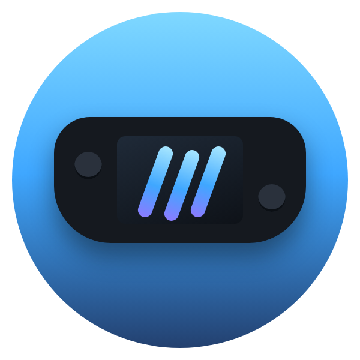
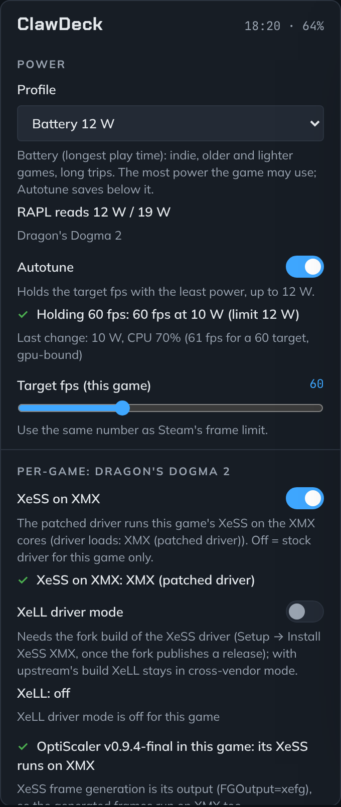
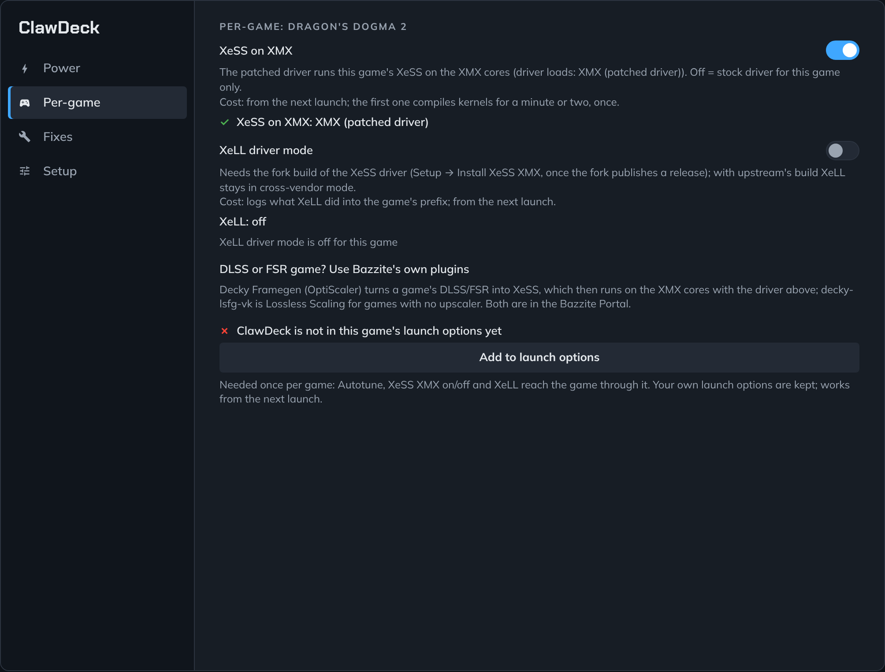
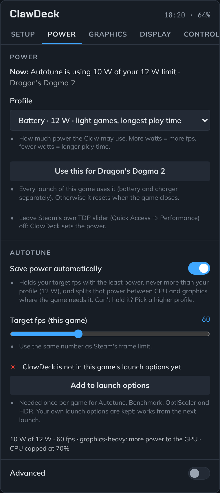
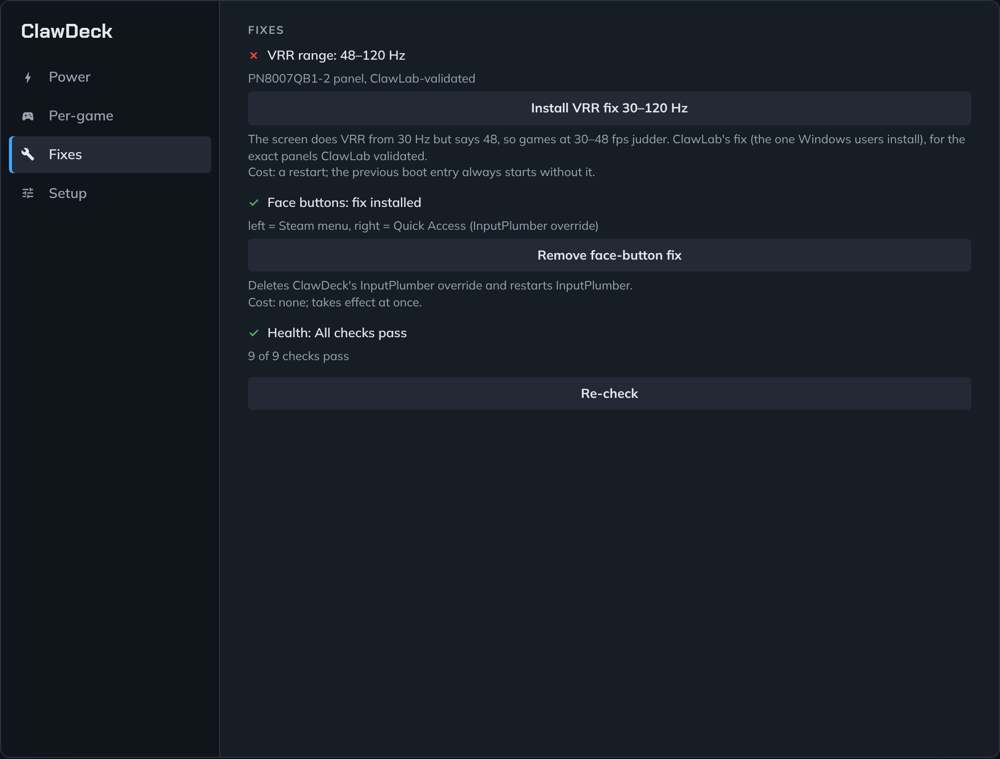

  

<h1 align="center">ClawDeck</h1>

<b>Power, battery, graphics and controller settings for the MSI Claw on Linux, right in Steam's Quick Access menu.</b>

  

  
  
  
  
  

  
  

  
  

---

## What is ClawDeck?

A free plugin for [Decky Loader](https://decky.xyz) that adds one ClawDeck panel to Steam's Quick Access menu (the
right MSI button) on the MSI Claw running [Bazzite](https://bazzite.gg). It does only what Bazzite and Steam's own
Quick Access do **not** already do:

- **XeSS on the XMX cores, with XeLL.** Installs the [xess-xmx-linux](https://github.com/HHHHanasak1/xess-xmx-linux)
  driver in one tap; from then every game's XeSS (or OptiScaler's) gets the same full-quality upscaling and 2–4x
  frame generation as on Windows, and Per-game turns it off for one game if it misbehaves. Per game it shows whether the driver loads and what XeLL (Intel's latency reduction) is doing, and lets
  you turn XeLL's driver mode on through [our fork](https://github.com/IHulkSmashI/xess-xmx-linux) once it ships.
- **VRR fix 30–120 Hz.** The Claw's screen can run VRR from 30 Hz, but tells the system 48, so games below 48 fps
  judder. One tap installs ClawLab's fix (the one Windows users install) for the exact screens ClawLab tested.
- **MSI buttons fixed on the Claw 8 EX.** On current Bazzite the two face buttons do nothing in Game Mode. One tap
  gives InputPlumber the right map for the EX: left = Steam menu, right = Quick Access.
- **Power profiles, a real TDP slider and Autotune.** Six profiles from Battery saver 10 W to Max 35 W and a slider
  over the chip's whole 8–35 W range, set through the chip's own limit (Steam's TDP slider does nothing on the Claw
  8 EX), read back after every change.
- **Autotune, no target to set.** It measures the most frames your TDP gives in the running game, shares that power
  between CPU and graphics where the game needs it, then lowers the TDP 1 W at a time while the game stays within
  5 % of those frames. It counts the frames the game renders, not the extra ones XeSS frame generation adds, so 2x or
  3x frame generation never fools it.
- **Every change reads back.** Each control shows what the hardware reports after the write; a failed write is red
  text with the reason, never a silent "applied".

**What Bazzite already does, so ClawDeck doesn't:** refresh rate, VRR on/off, HDR and the frame limit (Steam's
Performance panel); the MSI buttons, gyro and back buttons (InputPlumber); fan curves (the firmware); OptiScaler per
game (Decky Framegen, in the Bazzite Portal) and Lossless Scaling (decky-lsfg-vk). Use those; ClawDeck only adds
what is missing.

Made for the **MSI Claw 8 EX AI+**. It should also work on the Claw 8 AI+, 7 AI+, A1M and A8 (see
[the questions](#questions) for what differs).

> **Not released yet.** ClawDeck is brand new and is being tested on a Claw right now. The first download appears
> under [Releases](https://github.com/IHulkSmashI/ClawDeck/releases) once that testing is done. Power changes are
> undone when you close the game or remove the plugin.

---

## The four panels

Everything is in the Quick Access panel; **More details** at the bottom opens the same four as a full-screen page
with the longer explanations. Every explanation sits under its control, so the D-pad reaches it.

### Power
| Control | What it does |
|---|---|
| **Profile** | Battery saver 10 W, Battery 12 W, Balanced 17 W, Performance 25 W, Plugged 30 W or Max 35 W (what each is for, and what it costs, is under the control). The most power the game may use. |
| **TDP slider** | The same limit, anywhere from 8 to 35 W in 1 W steps. Moving it makes a *Custom* profile; picking a profile moves it. Under it, after every change: **"TDP 17 W (read back from RAPL)"**, the limit the hardware reports. Why ClawDeck sets TDP at all: Steam's TDP slider does nothing on the Claw 8 EX (PowerStation reports no TDP range for this chip). |
| **Autotune** | No target to set. For the running game it (1) measures the most frames the TDP above gives, (2) shares that power between CPU and graphics: when graphics hold the game back it gives them the CPU's spare share and a higher clock floor, when the CPU does it turns CPU boost on and its ceiling back to 100 %, and it keeps a change only if the game gets faster, (3) lowers the TDP 1 W at a time while the game stays within 5 % of the most, trying the CPU/graphics balance again at each step, and (4) holds there, measuring again in a new area, after a graphics change, or every few minutes. It counts rendered frames: with XeSS frame generation the screen shows 2–4 frames per rendered one, and Autotune reads the real rate from XeLL through the XMX driver. The status line: "Autotune: 25 W max → using 17 W · 58 fps (97 % of 60) · 3.4 fps/W", and under it what holds the game back and the last action ("CPU-bound · holding · raised CPU ceiling to 100 %"). With a frame limit (Steam's or the game's) the most the TDP gives is the limit, so Autotune holds it with the least power. |
| **Temperature guard** | Automatic, nothing to set. Bazzite's thermald rewrites the TDP every few seconds on this chip, so ClawDeck pauses it while it holds a TDP and restarts it when the game closes. While it is paused, ClawDeck watches the CPU package temperature itself: above 95 °C it steps the TDP down 2 W every 10 s until the package is under 90 °C, never below Autotune's floor. The read-back line then says **"thermal: stepped to 15 W"**. The stepped TDP stays until you pick a profile or move the slider. The chip's own heat limit and the fan control keep working throughout. |
| **Advanced** | Folded away: CPU boost, CPU ceiling %, GPU floor and ceiling MHz, CPU energy mode, how close to the most Autotune must stay (2–15 %, 5 % by default), and Autotune's floor. Steam has none of these for this chip. Each shows what the hardware reads; a change here pauses Autotune for the game. |

**The six profiles** (Claw 8 EX values; other Claws are capped at their own maximum):

| Profile | Power limit | CPU | Use it for |
|---|---|---|---|
| **Battery saver** | 10 W | up to 60 %, most-battery mode | 2D, indie and old games. Longest play time. |
| **Battery** | 12 W | up to 70 %, energy-saving mode | Light games, long trips. |
| **Balanced** | 17 W | up to 85 %, energy-saving mode | Newer, heavier games when you're not near a charger. |
| **Performance** | 25 W | full speed, balanced mode | Plugged in, playing handheld. |
| **Plugged** | 30 W | full speed, balanced mode | Heavy games on the charger. Warm. |
| **Max** | 35 W, boost to 45 W | full speed, performance mode | On a dock with a TV. Fans get audible. |

Why so low on battery? The Claw's Intel chip gets most of its frames by about 12–17 W; above that, each extra watt
buys few frames and a lot of battery. That is also why Autotune keeps "within 5 % of the most" rather than chasing
the best frames per watt: frames per watt keep improving all the way down to 8 W, long after the game stops being
playable. For a frame limit, use Steam's own; ClawDeck doesn't add a second limiter.

### Per-game (the running game)
| Control | What it does |
|---|---|
| **XeSS on XMX** | The patched driver runs this game's XeSS on the XMX cores. Off = the stock driver for this game only. |
| **XeLL driver mode** | Intel's latency reduction gets real GPU timings from the shim instead of pacing blind. Needs the fork build of the driver; the line under it says whether XeLL ran in driver mode, cross-vendor mode, or not at all in the last launch. |
| **Add to launch options** | Once per game: Autotune, XeSS XMX on/off and XeLL reach the game through ClawDeck's launch wrapper. Your own launch options are kept. |

A game that only ships DLSS or FSR: set it up with Bazzite's **Decky Framegen** (OptiScaler) and it uses XeSS, which
the driver above then runs on the XMX cores. A game with no upscaler at all: Bazzite's **decky-lsfg-vk**.

### Fixes
| Control | What it does |
|---|---|
| **VRR fix 30–120 Hz** | Install / remove ClawLab's EDID fix. Takes effect after a restart; the previous boot entry always starts without it. |
| **Face-button fix** (Claw 8 EX) | Install / remove the InputPlumber override. |
| **Health** | One line: all checks pass, or what needs fixing (the full list on the page). |

### Setup
| Control | What it does |
|---|---|
| **Install XeSS XMX** | Downloads the driver (the fork's release when it has one; otherwise upstream's, and it says so) and runs its installer as you, never as root. Log out and in once after. |
| **Run self-test** | Writes each control, reads it back, measures it and reverts (`tools/selftest.py`); shows PASS/FAIL per control. |
| **Export log** | One file on the Desktop for a bug report. |

---

## Install

You need an MSI Claw running [Bazzite](https://bazzite.gg) (or another Linux with
[Decky Loader](https://decky.xyz)). New to Linux? Our [step-by-step guide](docs/INSTALL-BAZZITE.md) goes from Windows
to Bazzite, with Windows staying on your Claw.

1. Install **Decky Loader**: on Bazzite, open the **Bazzite Portal** and tick Decky Loader.
2. Download **ClawDeck.zip** from [Releases](https://github.com/IHulkSmashI/ClawDeck/releases).
3. Open **Quick Access → Decky (plug icon) → gear icon** and turn on **Developer mode**. Then open the new
   **Developer** section, choose **Install plugin from ZIP file** and pick ClawDeck.zip.
4. Open **ClawDeck**. **Fixes** lists what the hardware gets wrong, with an Install button each; **Setup** installs
   the XeSS XMX driver.
5. Start a game, open **ClawDeck**, pick a profile or move the TDP slider, and turn on **Autotune**. Tap **Add to launch
   options** once for that game (Per-game).

To remove it: Decky → gear → ClawDeck → Uninstall. Power goes back to how it was, games you added ClawDeck to keep
starting normally, and the VRR fix resets at the next reboot. The MSI button fix stays, so the buttons keep working.

---

## Questions

**Does it drain my battery?** No. ClawDeck sleeps until you touch it. While a game runs, Autotune checks once a
second for as long as you play, so it notices when you change graphics settings or reach a heavier area. Each check
reads a few small files and takes well under a thousandth of a second of CPU time (measured: about 0.01 % of one
core). When it measures again (a new area, a graphics change, every few minutes) it spends about half a minute at
the full TDP you set. With no game running, nothing runs at all.

**Does frame generation fool Autotune?** No. With XeSS frame generation the game renders one frame and the screen
shows two to four; MangoHud counts all of them. Autotune reads the rendered rate from XeLL, which the XMX driver's
shim logs once per rendered frame, and shows both ("30 fps rendered, 2x shown"). A game without XeLL has no XeSS
frame generation, so what MangoHud counts is what it renders. (Frame generation from OptiScaler's FSR or from
Lossless Scaling doesn't go through XeLL: there Autotune still works, because it compares the game against itself
at the same multiplier, but the fps it shows include generated frames.)

**Can it damage my Claw?** No. It never overclocks: every power limit stays inside what MSI's firmware allows. Power
changes are undone when the game closes or when you remove the plugin. The things that stay on purpose are the two
fixes you install yourself: the MSI button fix and the VRR fix 30–120 Hz; the latter applies only to screens
ClawLab tested, and the previous entry in the boot menu always starts without it.

**Steam already has a Performance menu. Why use this?** Steam gives you one TDP slider for everything, and on the Claw
8 EX it may not change anything on current Bazzite. ClawDeck sets the Claw's power limit directly, reads it back,
and adds Autotune. Leave Steam's TDP slider off so the two don't fight. Steam's frame limit is fine to keep:
Autotune then holds it with the least power. Everything Steam's panels already do (refresh rate, VRR on/off, HDR, the
frame limit) stays there.

**What are the XMX cores, and which games use them?** They are the AI units in the Claw's Arc graphics. XeSS
upscaling and XeSS frame generation run on them, so games look sharper and run faster for the same battery. Games
that ship XeSS use them once the XeSS driver is installed (Setup). Games that only ship DLSS or FSR use them
through OptiScaler, which Bazzite's Decky Framegen plugin sets up.

**What is XeLL, and why a fork?** XeLL is Intel's latency reduction, used with XeSS frame generation. Under Proton
it runs in a cross-vendor mode that paces blind; its driver mode needs the graphics driver to hand it GPU timings.
Our fork of xess-xmx-linux adds that (pull requests #23 and #24 upstream). Until the fork publishes a release,
ClawDeck installs upstream's driver and the XeLL switch says so.

**Where is OptiScaler / Lossless Scaling?** In Bazzite: Decky Framegen and decky-lsfg-vk, both in the Bazzite
Portal. ClawDeck doesn't duplicate them; the XMX driver makes their XeSS output run on the XMX cores.

**What happens when Bazzite updates?** ClawDeck notices a new kernel, graphics driver or controller service the next
time it starts, runs its health check again, and tells you either "all checks still pass" or what needs a look.

**I have a different Claw.** The Claw 8 AI+ and 7 AI+ get everything. The A1M and the AMD-based A8 have no XMX
cores, so the XeSS-on-XMX features don't help there; power and the fixes work the same. If your Claw isn't
recognised, tap the fix button in Setup: it saves a hardware report you can post in an issue.

**Does it work on SteamOS or other handhelds?** It should run wherever Decky Loader does, but it's built and tested
for the MSI Claw on Bazzite.

---

## Help and feedback

- **Something broken?** ClawDeck → Setup → **Save a bug report to Desktop**, then
  [open an issue](https://github.com/IHulkSmashI/ClawDeck/issues/new/choose) and attach the file.
- **Ideas?** [Open a feature request](https://github.com/IHulkSmashI/ClawDeck/issues/new/choose).
- **Want to help build it?** See [CONTRIBUTING.md](CONTRIBUTING.md).

## Thanks

ClawDeck stands on the work of xess-xmx-linux, ClawLab, InputPlumber, PowerStation, Handheld Daemon,
PowerControl, SimpleDeckyTDP, MangoHud, Decky Loader and Bazzite. The feature set takes after ClawTweaks on Windows.
The full list is in [CREDITS.md](CREDITS.md).

## Support

ClawDeck is free and always will be. If it saves you battery or time, you can buy the project a coffee at
[ko-fi.com/gamervault](https://ko-fi.com/gamervault).

## License

[MIT](LICENSE). ClawDeck is a community project and isn't affiliated with MSI, Valve, Intel or Microsoft. "Claw" is a
trademark of MSI.
