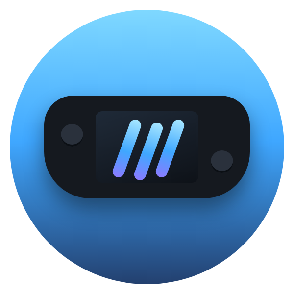
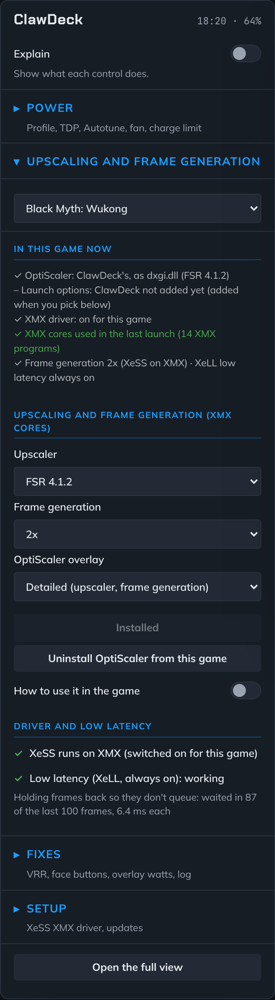
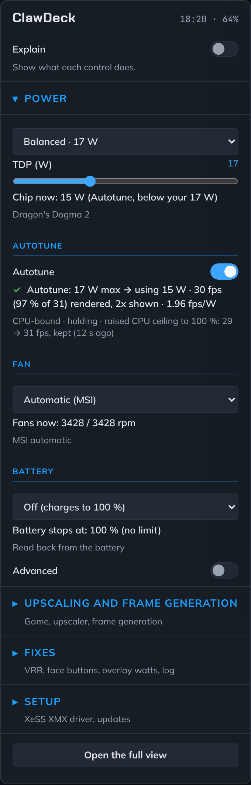
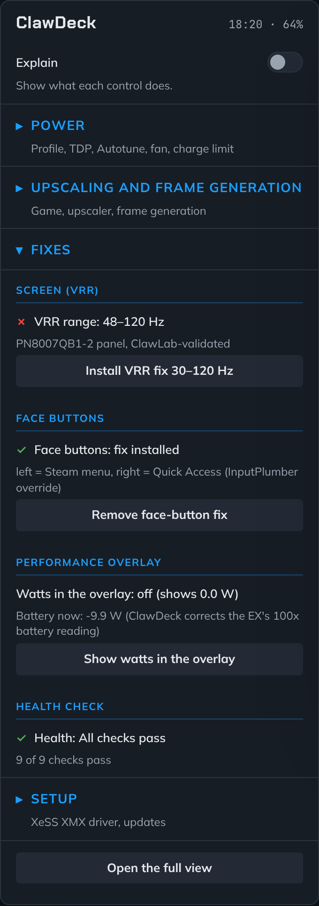
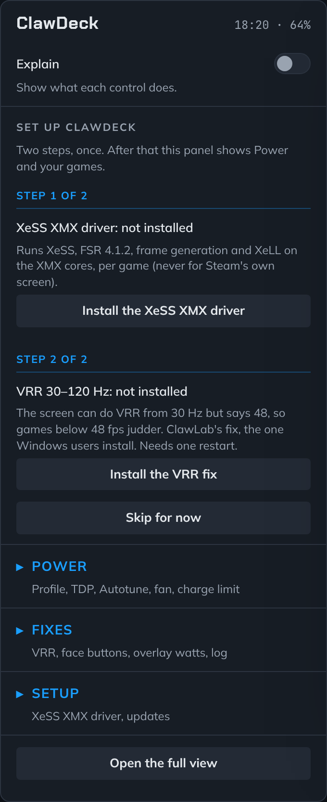

<p align="center">
  
</p>

<h1 align="center">ClawDeck</h1>

<p align="center"><b>Everything an Intel MSI Claw needs on Linux, in one Decky plugin.<br>FSR 4.1.2 and XeSS on the XMX cores, XeSS frame generation with low latency, power, fans and the fixes,<br>all from Steam's Quick Access menu.</b></p>

<p align="center">
  <a href="https://github.com/IHulkSmashI/ClawDeck/releases"></a>
  <a href="https://github.com/IHulkSmashI/ClawDeck/releases"></a>
  <a href="https://github.com/IHulkSmashI/ClawDeck/commits/main"></a>
  <br>
  <a href="#contents"></a>
  <a href="https://github.com/IHulkSmashI/ClawDeck/discussions"></a>
  <a href="https://github.com/IHulkSmashI/ClawDeck/issues/new?template=game_report.yml"></a>
  <br>
  <a href="https://ko-fi.com/gamervault"></a>
  <a href="LICENSE"></a>
</p>

<p align="center">
  
  
  
</p>

## One plugin, the whole Claw

Upscaling, frame generation, power, fans and the fixes the Claw needs, from one panel in Quick Access, with no
terminal after the install.

- 🔥 **FSR 4.1.2 on the XMX cores.** AMD's best upscaler, rebuilt for Intel's AI cores (nitec's build, shared with his
  OK). ClawDeck downloads it for you and offers it in DirectX 12 games with DLSS or FSR: the best image the Claw can get.
- ⚡ **XeSS 2 on XMX**, the real Intel path, not the slower DP4a fallback Linux gives you out of the box.
- 🎞️ **XeSS frame generation** with **XeLL low latency always on**, so the extra frames don't cost you the feel.
- 🎮 **One tap per game.** Pick the game, pick the upscaler and frame generation, tap Install. ClawDeck installs a
  pinned, tested OptiScaler, applies the per-game fixes OptiScaler's developers publish, and adds REFramework to
  Capcom games, which need it to start. Uninstall puts every original file back.
- 🔋 **Power that works:** profiles from 8 to 35 W (Steam's own TDP slider does nothing on the Claw 8 EX), Autotune
  to find the lowest wattage that keeps your frame rate, fan curves and a battery charge limit.
- 🛠️ **The fixes Bazzite doesn't have yet:** the 30–120 Hz VRR range, the two MSI face buttons, real watts in the
  performance overlay, and a system log flood that costs battery.

**Tested on:** MSI Claw 8 EX AI+ (Intel Core Ultra, Panther Lake, Arc B390 graphics) on Bazzite, mainly with
CONTROL Resonant and Onimusha: Way of the Sword. The Claw 8 AI+ and 7 AI+ should get everything too (tell us!), and
the older A1M and A8 get power and fixes.

> **Beta.** We test every build on a Claw 8 EX before it goes under
> [Releases](https://github.com/IHulkSmashI/ClawDeck/releases). Screenshots are from the preview with example data.
> Tried it? Tell us how your games run: [Feedback](#feedback).

### Quick install

1. Install **Decky Loader** (Bazzite: **Bazzite Portal** → tick **Decky Loader**).
2. In Desktop Mode, open **Konsole** and paste:
   ```
   curl -fsSL https://raw.githubusercontent.com/IHulkSmashI/ClawDeck/main/tools/update-from-main.sh | bash
   ```
3. Back in Game Mode: Quick Access → **ClawDeck** → follow **Set up ClawDeck** (two taps and one restart).

The full walkthrough is under [Install](#install).

---

## Contents

1. [What ClawDeck does](#what-clawdeck-does)
2. [Install](#install)
3. [Set up a game, step by step](#set-up-a-game-step-by-step)
4. [FSR 4.1.2 files](#fsr-412-files)
5. [Updates and safety](#updates-and-safety)
6. [Troubleshooting](#troubleshooting)
7. [Uninstall everything](#uninstall-everything)
8. [Credits](#credits)
9. [Feedback](#feedback)

---

## What ClawDeck does

ClawDeck is a free [Decky Loader](https://decky.xyz) plugin. It adds one panel to Steam's Quick Access menu (the right
MSI button). The panel is four headings that fold open and shut: **Power**, **Upscaling and frame generation**,
**Fixes** and **Setup**. When ClawDeck starts, one is open: Upscaling and frame generation while a game runs,
otherwise Power. **Explain** at the top shows what each control does, why you'd use it and what it costs.

It reads OptiClick's public supported-game list and OptiScaler's public compatibility list to decide what each game
gets.

### Power

| Control | What it does |
|---|---|
| **Profile** | Battery saver, Battery, Balanced, Performance, Plugged, Max: the most power the game may use. Your pick shows at once. |
| **TDP (W)** | The same limit, 8–35 W in 1 W steps. Moving it makes a Custom profile. Steam's own TDP slider does nothing on the Claw 8 EX, so ClawDeck sets the chip's limit and reads it back. |
| **Autotune** | Finds the most frames your TDP gives in the running game, then lowers the TDP while the game stays within 5 % of that. It counts rendered frames, so frame generation doesn't fool it. |
| **Fan** | Automatic (MSI), Quiet, Cooling, Full speed, or Custom (your own six-point curve, under Advanced). The presets are ClawTweaks' ones. Automatic puts MSI's own curve back. |
| **Battery** | Charge limit: Off (charges to 100 %), 80 %, 90 % or Custom (50–100 %). Keeps the battery healthier on the charger. Steam doesn't offer this on the Claw. |
| **Advanced** | CPU boost, CPU ceiling, GPU clocks, GPU efficiency mode, CPU energy mode, Autotune's floor. |

### Upscaling and frame generation (one game at a time)

Pick a game from the list. Only games ClawDeck can set up are listed: games with DLSS, FSR or XeSS inside, or in the
per-game list. Then:

| Pick | Choices | What it means |
|---|---|---|
| **Upscaler** | XeSS 2, FSR 4.1.2, FSR 4.1.2 Lite | Everything runs on the XMX cores. XeSS 2 is Intel's own and the fastest. FSR 4.1.2 is AMD's FSR 4 rebuilt for Intel's XMX cores, the best image (you add its files, see [below](#fsr-412-files)). Lite is faster for a little less detail. FSR 4.1.2 only shows for DirectX 12 games. |
| **Frame generation** | Off, 2x, 3x, 4x | XeSS frame generation on the XMX cores: 2x adds one frame per rendered one, 3x two, 4x three. It uses the game's own frame generation when the game has one. |
| **OptiScaler overlay** | Off, FPS only, Simple, Detailed, Detailed + graph, Full, Full + graph | OptiScaler's own counter at the top right. It shows the upscaler in use and "(XeFG)" while frame generation runs, which Steam's overlay can't tell you. |

Then one button: **Install OptiScaler in this game**, then **Apply changes** after a new pick, and **Update
OptiScaler to X** when we've tested a newer one. **Uninstall OptiScaler from this game** is under it.

ClawDeck also does these on its own:
- **XeLL low latency is always on.** Frame generation adds a little input lag, and XeLL takes most of it back.
- **Capcom RE Engine games** (Onimusha, Resident Evil, Monster Hunter Wilds, Street Fighter 6…) get
  **REFramework** with OptiScaler, automatically. Without it, Capcom's anti-tamper stops the game.
- **Per-game fixes:** each game gets the settings OptiScaler's own developers publish for it (98 games).

**In this game now** at the top says what's really in the game: OptiScaler or not (and which file), REFramework,
ClawDeck in the launch options, the XMX driver, and **"XMX cores used in the last launch"**:

| Line | Meaning |
|---|---|
| ✓ green: *XMX cores used in the last launch (14 XMX programs)* | It worked: the XMX driver ran in the game and compiled its XMX programs. |
| ✗ red: *Last launch didn't use the XMX cores* | The game ran on the stock driver (slower DP4a XeSS, and FSR 4.1.2 draws nothing). Restart the game; if it stays red, see [Troubleshooting](#troubleshooting). |
| ✗ red: *An XMX program didn't compile* | That game falls back to DP4a. Save a report (Setup) and send it to us. |
| – *not used yet* | Start the game once. |

### Fixes

| Fix | What it does and why |
|---|---|
| **VRR fix 30–120 Hz** | The Claw's screen can do VRR from 30 Hz but tells the system 48, so games below 48 fps judder. This is ClawLab's fix. It needs one restart. |
| **Face buttons** (Claw 8 EX) | The two MSI buttons do nothing in Game Mode on current Bazzite. The fix maps them: left = Steam menu, right = Quick Access. |
| **Performance overlay** | Real watts in Steam's performance overlay. Linux hides the power counter by default; ClawDeck opens it at boot. |
| **System log** | Silences a split-lock log flood (thousands of lines a minute) that cost battery and erased crash logs. |
| **Health check** | One line: all checks pass, or what needs a look. |

### Setup

The XeSS XMX driver ([xess-xmx-linux](https://github.com/HHHHanasak1/xess-xmx-linux)), OptiScaler's state, a
self-test, and **Export log to Desktop** for bug reports.

**Supported:** tested on the **MSI Claw 8 EX AI+**. The Claw 8 AI+ and 7 AI+ should get everything. The A1M and A8
get power and fixes. For another model: Setup → **Export log to Desktop** and send it to us, and we'll add it.

**Not possible (yet):** gyro on the 7/8 AI+ and 8 EX (the sensor hub needs MSI firmware Linux doesn't have). Steam
shows four back buttons because InputPlumber presents the Claw as a Steam Deck controller. The Claw's two land on two
of them: press each in Steam's controller test to see which, and ignore the other two.

---

## Install

You need an MSI Claw running [Bazzite](https://bazzite.gg) or SteamOS. New to Linux? Our
[step-by-step guide](docs/INSTALL-BAZZITE.md) goes from Windows to Bazzite, with Windows staying on your Claw.

**1. Install Decky Loader.** On Bazzite: open the **Bazzite Portal** and tick **Decky Loader**.

**2. Install ClawDeck.** Until the first release, test builds install with one command. Switch to Desktop Mode, open
a terminal (Konsole) and paste:

```
curl -fsSL https://raw.githubusercontent.com/IHulkSmashI/ClawDeck/main/tools/update-from-main.sh | bash
```

It asks for your password once (to copy the plugin into Decky's folder) and restarts Decky. Run the same line again
to update.

Prefer not to use a terminal? Once a release is out, Decky can install it straight from Game Mode: Quick Access →
Decky → gear → **Developer mode** on → **Developer** → **Install plugin from URL**, and enter the
link of **ClawDeck.zip** from the [Releases](https://github.com/IHulkSmashI/ClawDeck/releases) page (it looks like
`https://github.com/IHulkSmashI/ClawDeck/releases/download/<version>/ClawDeck.zip`). (Or download **ClawDeck.zip** from
[Releases](https://github.com/IHulkSmashI/ClawDeck/releases) and use **Install plugin from ZIP file**.)

ClawDeck isn't in Decky's plugin store, so it won't show up there: use one of the ways above.

**3. Do the two first-run steps.** Back in Game Mode, open Quick Access → ClawDeck. The first time, it shows
**Set up ClawDeck**:

<p align="center"></p>

1. **Install the XeSS XMX driver** (about 260 MB, a minute or two). Without it, nothing runs on the XMX cores.
2. **Install the VRR fix**, then **restart the Claw** once.
3. Tap **Done: show the panel**.

The steps come back by themselves while the XMX driver is missing. The face-button fix and the log fix need no step:
ClawDeck applies them on its own.

---

## Set up a game, step by step

<p align="center"></p>

1. **Quick Access → ClawDeck → Upscaling and frame generation.** Pick the game in the list (the running game is
   picked for you).
2. **Upscaler:** XeSS 2, FSR 4.1.2 or FSR 4.1.2 Lite.
3. **Frame generation:** Off, 2x, 3x or 4x.
4. **OptiScaler overlay** (optional): Detailed shows the upscaler and "(XeFG)" while it plays.
5. Tap **Install OptiScaler in this game**. The first time, it downloads OptiScaler (about 55 MB). ClawDeck adds itself
   to the game's launch options, and Capcom games get REFramework too.
6. **Start the game.** The first start may take a minute or two longer while the XMX programs compile once.
7. **In the game's graphics settings, pick DLSS** as the upscaler (or FSR if the game has no DLSS), at the quality you
   like. OptiScaler swaps it for what you picked. **Pick it once.** Switching between DLSS and FSR while the game runs
   can crash it (CONTROL does). To change it, quit, change it in ClawDeck, start again.
8. **Frame generation:** turn on the game's own **DLSS Frame Generation** (or FSR Frame Generation) in its menu, any
   multiplier: you get what you picked in ClawDeck. Then **quit and start the game again**, because switching it on
   while the game runs can crash it.
9. **Check it worked:** press **Insert** for OptiScaler's menu, and press it again to close.
   - FSR 4.1.2: under **Upscalers** it says **FSR 3.X** (OptiScaler files FSR 4 under FSR 3.X), **Input: DLSS**, and
     under **FFX Settings → FFX Upscaler** it says **FSR 4.1.2** (not 4.0.2).
   - XeSS 2: XeSS under Upscalers, Input: DLSS.
   - Frame generation: **FG Output: XeFG**, **Active** ticked.
   - Back in ClawDeck: **✓ XMX cores used in the last launch**.
10. **No keyboard for Insert?** Steam button → Controller settings → Edit layout → pick a back button (M1 or M2) →
    Keyboard → **Insert**. Bind it in this game's layout only.

To change something later: pick again and tap **Apply changes**. Apply always writes exactly what you picked into
the game's OptiScaler settings, so changes made by hand in OptiScaler's menu are replaced.

**Why the game's DLSS option, on an Intel chip?** DLSS itself can't run on Intel graphics. The game's DLSS option is
only the input: the game hands OptiScaler the same data it would give DLSS, and OptiScaler runs XeSS or FSR 4.1.2
on the XMX cores with it.

---

## FSR 4.1.2 files

FSR 4.1.2 on the XMX cores is nitec's build of AMD's FSR 4, from the OptiScaler community (the OptiScaler Discord),
shared with ClawDeck with nitec's OK. **There's nothing to set up:** ClawDeck downloads the two files once
(`amd_fidelityfx_upscaler_dx12.dll`, `fsr-original.dll`, about 100 MB, each sha256 checked) into `~/fsr4-xmx`, and
FSR 4.1.2 and FSR 4.1.2 Lite appear in the Upscaler list for DirectX 12 games. Offline, a copy in Downloads (the two
files or their zip) is picked up instead.

You don't need Windows' `cabinet.dll`. The build unpacks its kernels with Windows' Compression API (LZMS), and
ClawDeck brings its own open `cabinet.dll` for that (`tools/cabinet-lzms`, LGPL, built on wimlib's LZMS decoder). It
goes next to the game's exe and comes out again with the rest. A `cabinet.dll` left in `fsr4-xmx` from before is not
used, and you can delete it.

If they don't appear, the note under the Upscaler says why: not a DirectX 12 game, or a file is missing.

---

## Updates and safety

- **Every download is pinned.** OptiScaler, OptiPatcher and REFramework are pinned to a tested version with its
  sha256 in [`assets/versions.json`](assets/versions.json). A download that doesn't match is refused.
- **Downloaded once.** OptiScaler is unpacked to `~/.local/share/clawdeck/optiscaler/<version>` and copied into each
  game from there.
- **The game's own files are backed up.** Before OptiScaler replaces a file in a game, the original goes to the
  game's `.clawdeck-optiscaler/` folder. **Uninstall OptiScaler from this game** puts every original back and removes
  everything ClawDeck and OptiScaler added, including OptiScaler's logs and cache.
- **Nothing updates untested.** When OptiScaler releases a new version, we test it on a Claw first, then pin it.
  Your games then show **Update OptiScaler to X**. Until you tap it, a game keeps the version it has.
- **We watch upstream daily.** [`tools/upstream_watch.py`](tools/upstream_watch.py) checks every project ClawDeck
  builds on (OptiScaler, xess-xmx-linux, InputPlumber, Bazzite, ClawLab) for new versions and format changes, so we
  notice a change before it breaks a Claw.
- **Every system change is revertible.** What a game and Autotune change is undone when the game closes (the limit you picked comes back), and everything is undone when the plugin is removed. The
  fan's Automatic and the charge limit's Off put the firmware's own settings back.

---

## Troubleshooting

| Problem | What to do |
|---|---|
| **Black picture** in the game (the HUD still shows) | Look at **XMX cores used in the last launch** in ClawDeck. Red means the game ran on the stock driver: restart the game. FSR 4.1.2 needs the XMX cores and draws nothing without them. XeSS 2 still works in that case. |
| **Locked at 30 fps, or 60 with frame generation** | VRR isn't on. Open … → Performance → turn **Enable VRR** off and on, and check **Fixes → VRR fix** is installed (it needs one restart). |
| **The game crashes when you change the upscaler or frame generation in its menu** | Switching mid-game crashes some games. Quit, change it in ClawDeck, start again. |
| **OptiScaler shows FSR 4.0.2 instead of 4.1.2** | Tap **Apply changes** in ClawDeck and restart the game. |
| **"Decky Framegen's" or "put there by another tool"** under In this game now | ClawDeck never touches OptiScaler it didn't install (you don't need Decky Framegen: ClawDeck brings its own). Remove that one first (Stop using Decky Framegen here, then Decky Framegen → Unpatch; or delete its OptiScaler.ini and DLL), then pick again. |
| **REFramework still loads after Uninstall OptiScaler** | ClawDeck takes out its own REFramework and any copy of the build it pins. Another REFramework (a different build put in by hand) stays, and the message says so: delete `dinput8.dll` next to the game's exe. |
| **A message was cut off** | Steam shows one line. The whole message stays at the top of Quick Access for two minutes. |
| **Anything else** | Setup → **Export log to Desktop**, then [open an issue](https://github.com/IHulkSmashI/ClawDeck/issues/new/choose) and attach the file. |

---

## Uninstall everything

1. For each game you set up: ClawDeck → the game → **Uninstall OptiScaler from this game**. The game's own files come
   back.
2. **Fixes:** remove the VRR fix (takes effect after a restart) and the face-button fix if you want them gone.
3. **Power:** set Fan to **Automatic (MSI)** and Battery to **Off**.
4. Decky → gear → ClawDeck → **Uninstall**. Power goes back to the firmware's own, and games keep starting normally.

---

## Credits

ClawDeck stands on the work of many projects: xess-xmx-linux, OptiScaler, nitec's FSR 4 build, REFramework,
ClawLab, ClawTweaks, OptiClick, InputPlumber, PowerStation, Handheld Daemon, MangoHud, Decky Loader and Bazzite. The
full list, with what each one does for ClawDeck, is in
[CREDITS.md](CREDITS.md).

## Feedback

ClawDeck is in beta, and what you see on your Claw decides what we work on next. Everything posted here gets read
and answered:

- **How a game runs** (good or bad): [Game report](https://github.com/IHulkSmashI/ClawDeck/issues/new?template=game_report.yml),
  a one-page form.
- **Ideas and feature requests:** [Discussions → Ideas](https://github.com/IHulkSmashI/ClawDeck/discussions/categories/ideas),
  where others can upvote them.
- **Questions:** [Discussions → Q&A](https://github.com/IHulkSmashI/ClawDeck/discussions/categories/q-a).
- **Something broke:** [Bug report](https://github.com/IHulkSmashI/ClawDeck/issues/new?template=bug_report.md), with
  the report file from Setup.

**Help:** [CONTRIBUTING.md](CONTRIBUTING.md) · ClawDeck is free; if you'd like to chip in:
[ko-fi.com/gamervault](https://ko-fi.com/gamervault).

[AGPLv3](LICENSE) (see [LICENSING.md](LICENSING.md)). ClawDeck is a community project, not affiliated with MSI, Valve, Intel, AMD or Microsoft. "Claw" is a
trademark of MSI.
