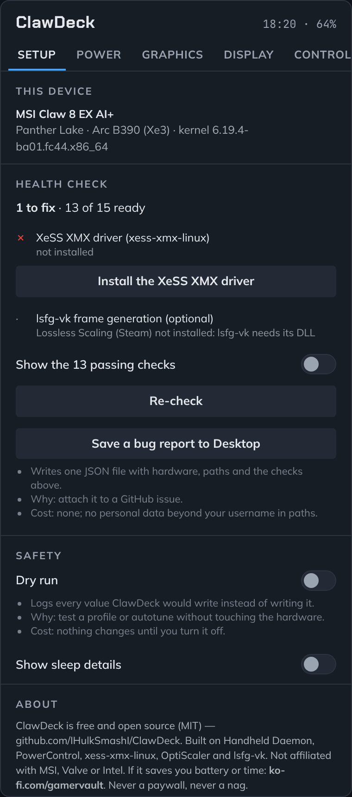
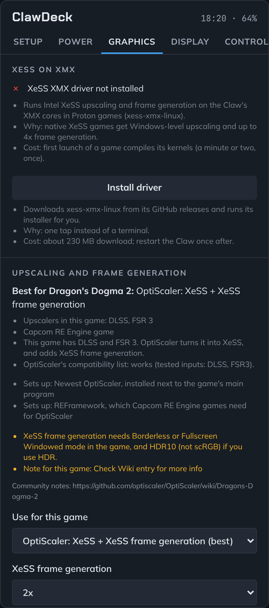
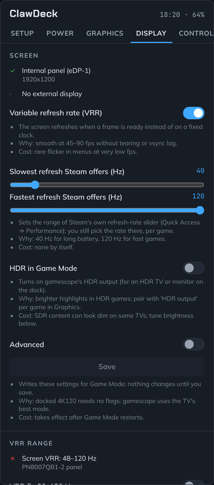
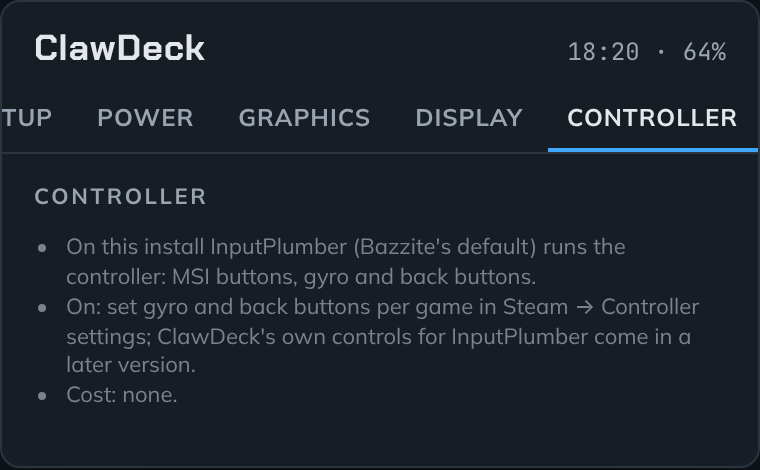
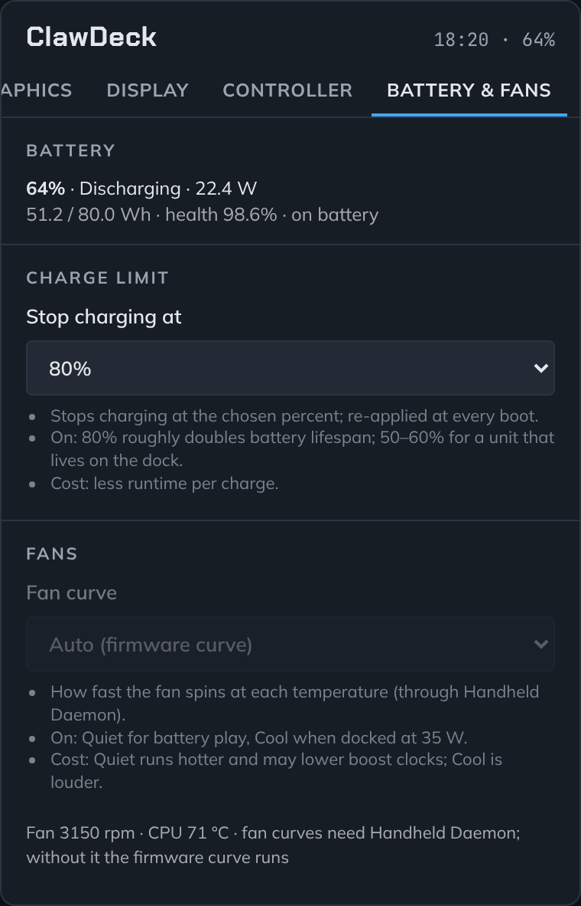

  

<h1 align="center">ClawDeck</h1>

<b>Power, battery, graphics and controller settings for the MSI Claw on Linux, right in Steam's Quick Access menu.</b>

  

  
  
  
  
  

  
  
  

  
  
  

---

## What is ClawDeck?

If you've used ClawTweaks or MSI Center M on Windows, ClawDeck is the same idea for Linux. It's a free plugin for
[Decky Loader](https://decky.xyz) that adds one ClawDeck panel to the Quick Access menu (the right MSI button). What
it does:

- **VRR fix 30–120 Hz.** The Claw's screen can run VRR from 30 Hz, but tells the system 48, so games below 48 fps
  judder. One tap applies ClawLab's fix (the one Windows users install) for the exact screens ClawLab tested.
- **Real power control on the Claw 8 EX.** Steam's own TDP slider may do nothing on this model under current
  Bazzite; ClawDeck sets the Claw's power limit directly, inside the limits MSI's firmware allows.
- **Four power profiles, per game:** Battery, Balanced, Performance and Dock, in one tap. Save one per game and it
  switches by itself when you plug in or unplug.
- **Autotune** finds the lowest power that holds your target fps in each game, using the GPU's real load.
- **XeSS on the Claw's XMX cores**, even in games that only ship DLSS or FSR: ClawDeck picks the best option per game
  and sets up the newest OptiScaler, OptiPatcher and REFramework for you. Lossless Scaling is the last resort for
  games with nothing else.
- **Always up to date:** OptiScaler, lsfg-vk and Moonlight update themselves, checked against their published
  checksums, with one-tap rollback.
- **Stream games from your PC** with Moonlight VRR, ready for Vibepollo, Apollo or Sunshine.
- **Battery that reads right and lasts longer:** charge, watts and health shown correctly for the Claw, and a
  charge limit from 50 to 100 %.
- **Works with Bazzite, not against it:** it shows what InputPlumber (the controller service) and PowerStation (the
  power service) are doing, and never installs a second controller service.
- **Health check:** see at a glance what's working and what isn't, with a one-tap fix.

Made for the **MSI Claw 8 EX AI+** on [Bazzite](https://bazzite.gg). It should also work on the Claw 8 AI+, 7 AI+,
A1M and A8 (see [the questions](#questions) for what differs).

> **Not released yet.** ClawDeck is brand new and is being tested on a Claw right now. The first download appears
> under [Releases](https://github.com/IHulkSmashI/ClawDeck/releases) once that testing is done. Everything it changes
> is undone when you close the game or remove the plugin, and **Dry run** (Setup tab) lets you try it without
> changing anything.

---

## What each tab does

### Setup
| Feature | What it does |
|---|---|
| **Health check** | Checks your Claw, graphics driver, controller, battery and more. Anything missing shows up first, with a button to fix it. |
| **Bug report** | Saves one file to your Desktop with everything we need to help you. Attach it to a GitHub issue. |
| **Dry run** | ClawDeck shows what it *would* change, without changing anything. Good for trying things safely. |

### Power
| Feature | What it does | Good to know |
|---|---|---|
| **Profiles** | Four levels of power in one tap (see the table below). Save one per game: it switches by itself when you plug in or unplug. | Goes back to normal when the game closes, unless you saved it. |
| **Autotune** | Set a target fps for a game. Autotune learns the lowest power that keeps it there, and uses that every time you play. | The first few minutes in a new game can stutter while it learns. |
| **TDP and clocks** | Pick the power limit. Under **Advanced**: TDP boost on or off, CPU energy mode, CPU and GPU limits. | Leave Steam's own TDP slider off. On the Claw 8 EX it may do nothing at all; on other Claws it sets the same limit, and the last change wins. |
| **Benchmark** | Records fps, 1% lows and watts for a game, so you can compare profiles with real numbers. | Under **Advanced**. |
| **Share profiles** | Export a game's settings as a file, or import someone else's. | Never overwrites a game you've already set up. |

**The four profiles** (Claw 8 EX values; other Claws are capped at their own maximum):

| Profile | Power limit | CPU | Use it for |
|---|---|---|---|
| **Battery** | 20 W | up to 80 %, energy-saving mode | Indie and older games, long trips. Longest play time. |
| **Balanced** | 25 W | up to 90 %, balanced mode | Newer, heavier games when you're not near a charger. More fps, shorter play time. |
| **Performance** | 30 W | full speed | Plugged in, playing handheld. |
| **Dock** | 35 W, boost to 45 W | full speed, performance mode | On a dock with a TV. Fans get audible. |

Not sure which to pick? Choose a target fps and turn on **Autotune**: it starts from the profile and lowers the power
until the game just holds your target. For a frame limit, use Steam's own (Quick Access → Performance → Frame
limit) and set Autotune's target to the same number; ClawDeck doesn't add a second frame limiter.

### Graphics
| Feature | What it does | Good to know |
|---|---|---|
| **XeSS on XMX** | Installs the [xess-xmx-linux](https://github.com/HHHHanasak1/xess-xmx-linux) driver in one tap, so games with XeSS get the same full-quality upscaling and frame generation as on Windows. | The first launch of each game takes a minute or two to prepare, once. |
| **Best option per game** | ClawDeck checks what each game ships (DLSS, FSR, XeSS), looks it up in OptiScaler's community compatibility list, and recommends one thing, with the reasons. | Online games with anti-cheat are left alone: changed game files can get accounts banned. |
| **OptiScaler, set up for you** | For DLSS or FSR games: one tap installs the newest OptiScaler, so the game uses XeSS on the XMX cores plus XeSS frame generation (2x to 4x). It also adds **OptiPatcher** when the game is supported, **REFramework** for Capcom RE Engine games, and the game's known fixes. | XeSS frame generation needs Borderless or Fullscreen Windowed mode. Adds a little input delay. |
| **Lossless Scaling** | The last option, for games with no DLSS, FSR or XeSS: frame generation through lsfg-vk. ClawDeck installs lsfg-vk and checks that Lossless Scaling is in your Steam library. | You need your own copy of [Lossless Scaling](https://store.steampowered.com/app/993090/Lossless_Scaling/) (a paid Steam app). It runs on the GPU's regular shader cores, not the XMX cores. |
| **Always up to date** | Checks once a day for new OptiScaler, OptiPatcher, REFramework, lsfg-vk and Moonlight versions, checks each download against its published checksum, and updates your games right after you close them. | If an update causes trouble, go back to the previous version in one tap. Can be turned off under Updates. |
| **Proton version** | Pick which Proton runs a game, such as GE-Proton. | Same as the game's Properties → Compatibility, just closer to hand. |
| **Add to launch options** | One tap adds ClawDeck to a game's launch options, which Autotune, the injector and HDR need. | Keeps anything you already had there. |

### Display and streaming
| Feature | What it does |
|---|---|
| **VRR** | The screen refreshes as each frame is ready, for smooth play without tearing. |
| **VRR fix 30–120 Hz** | The Claw 8 AI+ / 8 EX and A1M / 7 AI+ screens can do 30–120 Hz, but tell the system 48–120 Hz, so games below 48 fps judder. One tap applies [ClawLab](https://github.com/Zendo-GIT/Intel-Handheld-and-ARC-GPU-laboratory)'s fix, the same one Windows users install, for the exact screens ClawLab tested. Takes effect after a restart; turn it off to undo. |
| **Refresh range** | Sets which refresh rates Steam's own refresh slider offers. |
| **HDR** | Turns on HDR for a TV or monitor on the dock. |
| **Stream from your PC** | Installs [Moonlight with VRR](https://github.com/Nonary/moonlight-qt) and adds it to Steam. Save your PC's address to get a one-tap "Stream" shortcut. Works with [Vibepollo](https://github.com/Nonary/Vibepollo), Apollo or Sunshine on the PC. |

Display settings apply after Game Mode restarts. On the dock, the Claw picks your TV's best mode by itself. To leave a
stream, hold View + Menu + LB + RB.

### Controller
Shows what runs the MSI buttons, gyro and lights. On current Bazzite that's InputPlumber: the tab shows your
controller and its profile, and you set buttons and gyro in Steam's own controller settings, as usual. On Claws running Handheld Daemon instead, this tab also offers gyro,
button layout and stick lighting. ClawDeck works with whichever your Claw has and never runs both.

### Battery & Fans
| Feature | What it does | Good to know |
|---|---|---|
| **Charge limit** | Stops charging at 50, 60, 70, 80, 90 or 100 %. | Batteries wear slower when they don't sit at 100 %. 80 % is a good everyday choice, 50 to 60 % if your Claw lives on the dock. |
| **Fans** | Shows fan speed and temperature. On Claws running Handheld Daemon: Auto, Quiet, Balanced or Cool presets. | On current Bazzite, the Claw's own fan curve runs. Fan presets without Handheld Daemon are planned. |

---

## Install

You need an MSI Claw running [Bazzite](https://bazzite.gg) (or another Linux with
[Decky Loader](https://decky.xyz)). New to Linux? Our [step-by-step guide](docs/INSTALL-BAZZITE.md) goes from Windows
to Bazzite, with Windows staying on your Claw.

1. Install **Decky Loader**: on Bazzite, open the **Bazzite Portal** and tick Decky Loader.
2. Download **ClawDeck.zip** from [Releases](https://github.com/IHulkSmashI/ClawDeck/releases).
3. Open **Quick Access → Decky (plug icon) → gear icon** and turn on **Developer mode**. Then open the new
   **Developer** section, choose **Install plugin from ZIP file** and pick ClawDeck.zip.
4. Open **ClawDeck → Setup**. Fix anything the health check lists.
5. Start a game, open **ClawDeck → Power**, pick a profile and a target fps, and tap **Add to launch options**.

To remove it: Decky → gear → ClawDeck → Uninstall. Power, display and fan settings go back to how they were, and
games you added ClawDeck to keep starting normally. The charge limit and the VRR fix 30–120 Hz reset at the next
reboot.

---

## Questions

**Does it drain my battery?** No. ClawDeck sleeps until you touch it. Only Autotune and Benchmark do anything while
you play, and they check once a second while their game runs.

**Can it damage my Claw?** No. It never overclocks: every power limit stays inside what MSI's firmware allows. Power
changes are undone when the game closes, when you tap *Revert to defaults*, or when you remove the plugin. The two
things that stay on purpose are the charge limit and, if you turn it on, the VRR fix 30–120 Hz; it applies only to
screens ClawLab tested, and the previous entry in the boot menu always starts without it.

**Steam already has a Performance menu. Why use this?** Steam gives you one TDP slider for everything, and on the Claw
8 EX it may not change anything on current Bazzite. ClawDeck sets the Claw's power limit directly, and adds profiles
per game that switch when you plug in, Autotune, CPU and GPU limits, and a benchmark to compare them. Leave Steam's
TDP slider off so the two don't fight. Steam's frame limit is fine to keep: set Autotune's target to the same
number.

**What are the XMX cores, and which games use them?** They are the AI units in the Claw's Arc graphics. XeSS
upscaling and XeSS frame generation run on them, so games look sharper and run faster for the same battery. Games
that ship XeSS use them once the XeSS driver is installed (Graphics tab). Games that only ship DLSS or FSR use them
through OptiScaler, which ClawDeck sets up for you.

**Do I have to buy Lossless Scaling?** Only for the Lossless Scaling option, which is for games with no DLSS, FSR or
XeSS at all. lsfg-vk is free, but it uses the frame generation from your own copy of Lossless Scaling on Steam. It
runs on the regular shader cores rather than the XMX cores. OptiScaler and XeSS need nothing extra.

**Can OptiScaler get me banned online?** It can in games with anti-cheat, because it changes game files. That's why
ClawDeck won't set it up in those games. Many online games run fine on Linux; the ones with kernel-level anti-cheat
don't run at all. [Are We Anti-Cheat Yet?](https://areweanticheatyet.com) lists which is which.

**Bazzite also offers OptiScaler and Lossless Scaling plugins. Which should I use?** Either one, but only one per
game. ClawDeck spots the others and won't overwrite a game they've set up.

**What happens when Bazzite updates?** ClawDeck notices a new kernel, graphics driver or controller service the next
time it starts, runs its health check again, and tells you either "all checks still pass" or what needs a look.

**I have a different Claw.** The Claw 8 AI+ and 7 AI+ get everything. The A1M and the AMD-based A8 have no XMX
cores, so the XeSS-on-XMX features don't help there; power, battery and streaming work the same. If your Claw isn't
recognised, tap the fix button in Setup: it saves a hardware report you can post in an issue.

**Does it work on SteamOS or other handhelds?** It should run wherever Decky Loader does, but it's built and tested
for the MSI Claw on Bazzite.

---

## Help and feedback

- **Something broken?** ClawDeck → Setup → **Save a bug report to Desktop**, then
  [open an issue](https://github.com/IHulkSmashI/ClawDeck/issues/new/choose) and attach the file.
- **Ideas?** [Open a feature request](https://github.com/IHulkSmashI/ClawDeck/issues/new/choose).
- **Want to help build it?** See [CONTRIBUTING.md](CONTRIBUTING.md).

## Thanks

ClawDeck stands on the work of Handheld Daemon, InputPlumber, PowerStation, PowerControl, SimpleDeckyTDP,
xess-xmx-linux, OptiScaler, OptiPatcher, REFramework, lsfg-vk and Lossless Scaling, Moonlight and Nonary's VRR fork,
Vibepollo, Apollo and Sunshine, MangoHud, ClawLab, Decky Loader and Bazzite. The per-game OptiScaler setup follows OptiClick's
approach, and the feature set takes after ClawTweaks on Windows. The full list is in [CREDITS.md](CREDITS.md).

## Support

ClawDeck is free and always will be. If it saves you battery or time, you can buy the project a coffee at
[ko-fi.com/gamervault](https://ko-fi.com/gamervault).

## License

[MIT](LICENSE). ClawDeck is a community project and isn't affiliated with MSI, Valve, Intel or Microsoft. "Claw" is a
trademark of MSI.
